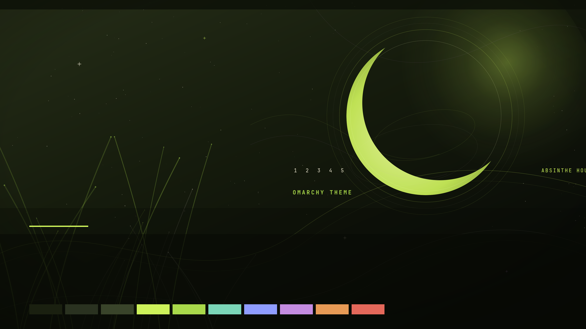

# Absinthe Hour

An art nouveau theme for [Omarchy](https://omarchy.org): deep olive night, a luminescent chartreuse glow, parchment text, and a chartreuse-to-orchid window border.



## Install

From the Omarchy menu: `SUPER + ALT + SPACE` → **Install** → **Style** → **Theme**, then paste the repository URL.

Or from a terminal:

```bash
omarchy theme install https://github.com/zaki2993/omarchy-absinthe-hour-theme
```

The theme is installed as **Absinthe Hour**.

## Wallpapers

Two original 3840 × 2160 wallpapers ship with the theme:

- **Absinthe Halo** — `backgrounds/1-absinthe-halo.jpg`
- **Absinthe Ripples** — `backgrounds/2-absinthe-ripples.jpg`

Cycle them with:

```bash
omarchy theme bg next
```


## Palette

| Role | Color |
| --- | --- |
| Background | `#1a2010` |
| Foreground | `#eee8d2` |
| Accent / absinthe glow | `#cdf25a` |
| Green | `#a9d94a` |
| Cyan | `#7bd6b8` |
| Blue | `#8f9dff` |
| Magenta / orchid | `#c48ce0` |
| Orange | `#e79a55` |
| Red | `#e4685a` |

## Included

- `colors.toml` for Omarchy's generated terminal, bar, launcher, editor, and GTK colors
- Two 4K wallpapers
- Theme switcher preview (`preview.png`)
- Yaru Olive icon theme
- Plymouth unlock assets (`unlock.png`, `preview-unlock.png`)

## Uninstall

```bash
omarchy theme remove absinthe-hour
```

## License

MIT. See [LICENSE](LICENSE).
